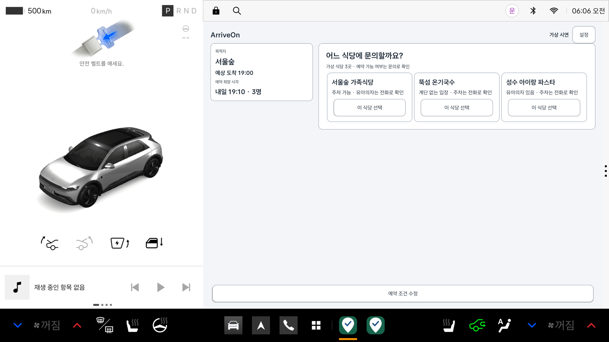
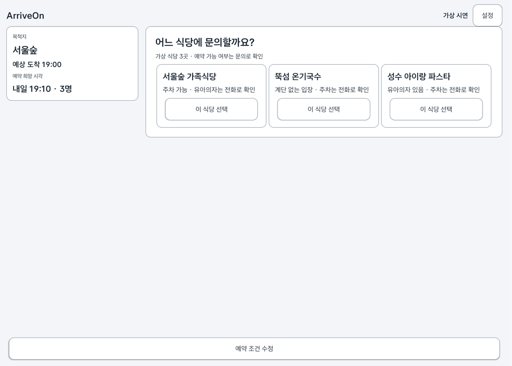
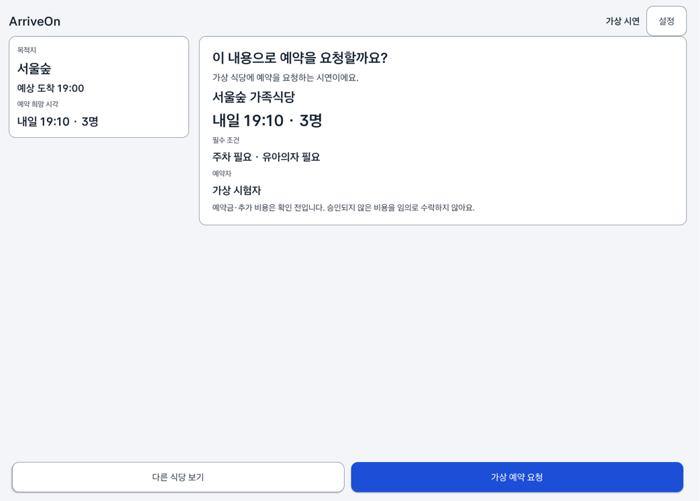
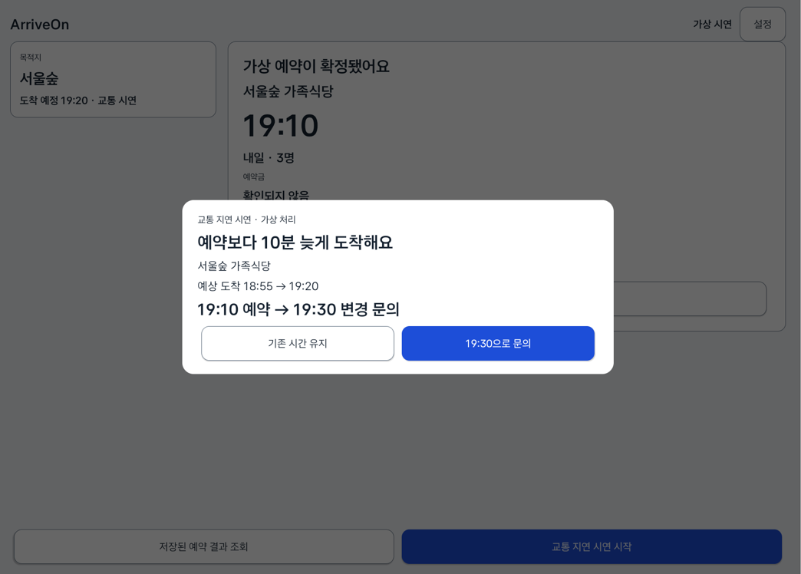
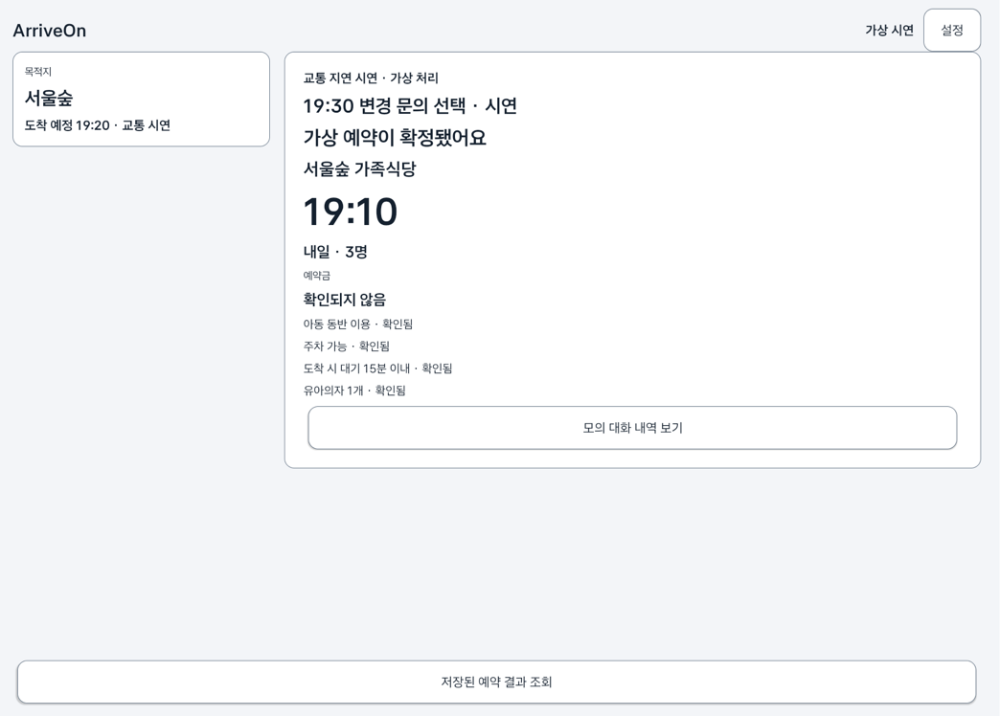
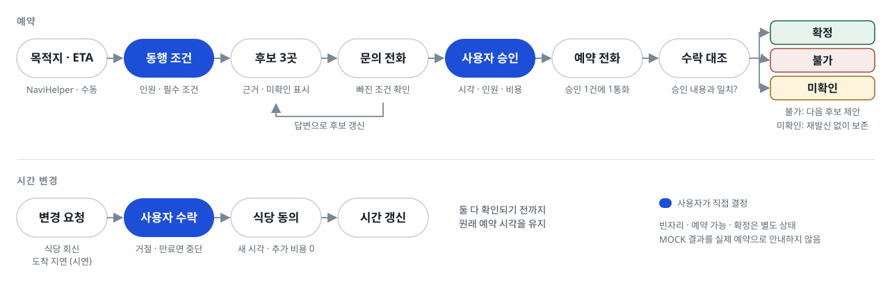
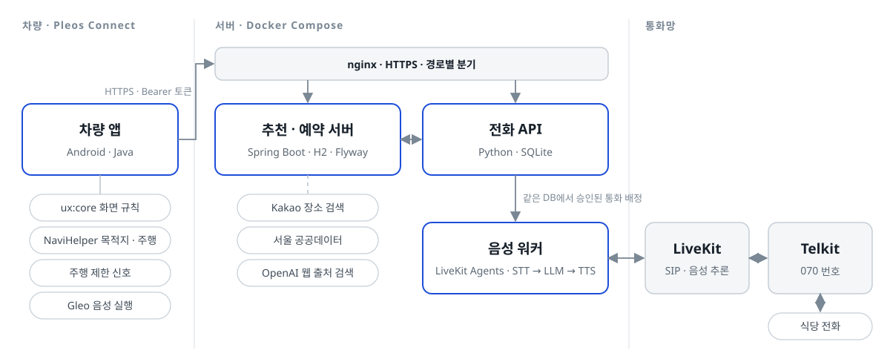
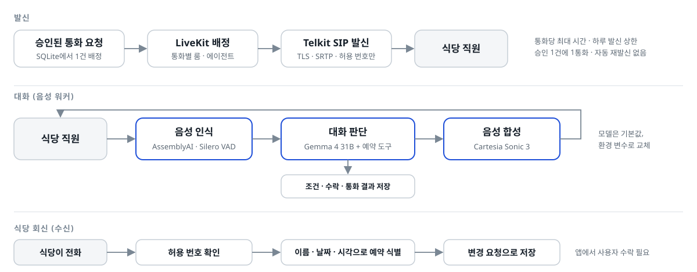

<p align="center">
  
</p>

<h1 align="center">ArriveOn</h1>

<p align="center">
  Pleos 차량용 AI 식당 예약 비서<br>
  목적지와 도착 시각에 맞춰 식당을 고르고, AI가 대신 전화해 예약까지 확인합니다.
</p>

<p align="center">
  <a href="https://github.com/arriveon-lab/pleos-reservation-assistant/actions/workflows/verify.yml"></a>
</p>

<p align="center">
  <a href="https://github.com/arriveon-lab/pleos-reservation-assistant/issues">작업 이슈</a> ·
  <a href="https://github.com/arriveon-lab/pleos-reservation-assistant/actions">CI</a> ·
  <a href="docs/STATUS.md">검증 현황</a> ·
  <a href="docs/README.md">팀 문서</a>
</p>

| 시연 영상 | APK |
| --- | --- |
| 준비 중 | 준비 중 (release 서명 전) |

| 서비스 | 개발 | 프로젝트 |
| --- | --- | --- |
| [어떤 서비스인가](#어떤-서비스인가)<br>[앱 화면](#앱-화면)<br>[예약 흐름](#예약-흐름)<br>[Pleos 플랫폼 활용](#pleos-플랫폼-활용)<br>[운전 중 안전](#운전-중-안전)<br>[AI 통화 원칙과 개인정보](#ai-통화-원칙과-개인정보)<br>[현재 상태](#현재-상태)<br>[다음 단계](#다음-단계) | [시스템 구성](#시스템-구성)<br>[설계 결정](#설계-결정)<br>[기술 스택](#기술-스택)<br>[저장소 구조](#저장소-구조)<br>[실행](#실행)<br>[설정](#설정)<br>[주요 API](#주요-api)<br>[테스트와 CI](#테스트와-ci) | [운영 원칙](#운영-원칙)<br>[팀](#팀)<br>[더 읽을거리](#더-읽을거리) |

---

## 어떤 서비스인가

토요일 오후, 아이 하나를 태우고 서울숲으로 가는 길입니다. 도착하면 바로 저녁을 먹고 싶은데, 주차가 되고 아기의자가 있고 7시쯤 자리가 있는 식당이어야 합니다. 이걸 알아보려면 지도 앱을 뒤지고, 리뷰를 읽고, 식당마다 전화해서 물어봐야 합니다. 운전 중에는 어느 하나도 하기 어렵습니다.

온라인 예약 서비스로 해결되지 않는 이유도 있습니다. 동네 식당 중에는 전화로만 예약을 받는 곳이 있고, 온라인 예약이 되는 곳도 아기의자, 계단 없는 입구, 주차 같은 동행 조건은 예약 화면에서 확인하기 어렵습니다. 결국 누군가 전화로 물어봐야 하는 부분을 AI가 대신 맡는 것이 이 서비스의 핵심입니다.

ArriveOn은 이 과정을 차량 화면 몇 번의 선택으로 줄입니다.

1. 내비게이션의 목적지와 도착 예정 시각을 기준으로 주변 식당을 찾습니다.
2. 오늘 함께 타는 사람의 필수 조건(인원, 아이, 주차, 계단 없는 출입 등)으로 후보를 최대 3곳까지 추립니다.
3. 공개 정보로 알 수 없는 조건은 "미확인"으로 남겨 두고, 필요하면 AI가 식당에 전화해 물어봅니다.
4. 사용자가 식당과 예약 내용을 승인하면 AI가 예약 전화를 걸고, 매장의 답변이 승인 내용과 맞을 때만 확정으로 기록합니다.
5. 예약 후 시간을 바꿔야 하면, 사용자 수락과 매장 동의를 모두 확인한 뒤에만 시간을 바꿉니다. 식당이 걸어오는 변경 회신은 구현돼 있고, 도착 지연을 자동으로 감지하는 기능은 현재 시연 데이터로만 동작합니다.

이 서비스에서 가장 중요하게 다룬 것은 "확실하지 않은 것을 확실하다고 말하지 않는 것"입니다. 빈자리가 있다는 것, 예약이 가능하다는 것, 예약이 확정됐다는 것은 서로 다른 상태로 저장합니다. 통화 결과가 애매하면 미확인으로 남기고 자동으로 다시 전화하지 않습니다. 식당 조건과 통화 결과에는 출처, 관측 시각, 확실성을 함께 기록합니다.

## 앱 화면

Pleos Connect 에뮬레이터에서 실행한 화면입니다. 왼쪽은 차량 기본 화면이고 오른쪽이 ArriveOn입니다. 화면의 식당, 예약자, 지연 상황은 시연용 가상 데이터입니다.



ArriveOn 안에서는 목적지와 예약 시각 요약을 왼쪽 카드에 고정하고, 지금 결정할 내용 하나만 오른쪽에 띄웁니다. 아래는 ArriveOn 영역만 잘라 단계별로 모은 것입니다.

| 1. 식당 고르기 | 2. 예약 요청 승인 |
| --- | --- |
|  |  |
| 후보 3곳을 보여 주고, 공개 정보로 확인된 조건과 전화로 확인해야 하는 조건을 카드마다 나눠 적습니다. | 식당, 시각, 인원, 필수 조건, 예약자를 확인한 뒤에만 예약 전화가 나갑니다. 식당을 고르는 것만으로는 전화하지 않고, 승인하지 않은 비용은 AI가 통화 중에 수락하지 않습니다. |

| 3. 도착 지연 안내 (시연) | 4. 변경 문의 중 원 예약 유지 |
| --- | --- |
|  |  |
| 몇 분 늦는지와 바꿀 시각을 함께 보여 주고, 기존 시간을 유지할지 새 시각으로 문의할지는 사용자가 고릅니다. | 19:30 변경을 문의해도 식당이 동의하기 전까지 확정 시각은 19:10으로 남습니다. 조건은 항목별로 확인 여부를 표시하고, 예약금처럼 확인되지 않은 값은 그대로 "확인되지 않음"으로 둡니다. |

## 예약 흐름



파란색으로 채운 단계는 사용자가 직접 결정해야 넘어갑니다. 서버는 정보 문의, 예약, 변경 통화를 구분해서 기록하고, 예약 상태는 대기, 확정, 거절, 미확인 네 가지로만 둡니다. 대기 시간 정보는 "지금 가면 몇 분"인지 "도착할 때 몇 분"인지 구분해서 저장하고 서로 바꿔 쓰지 않습니다.

## Pleos 플랫폼 활용

| 기능 | 사용한 것 | 쓰는 곳 | 확인 수준 |
| --- | --- | --- | --- |
| 목적지 · 주행 정보 | Pleos NaviHelper SDK 3.0.5 | 검색 기준 목적지와 도착 예정 시각 | 에뮬레이터에서 목적지 · TripInfo 수신 확인, ETA 시간 기준은 미검증 |
| 음성으로 앱 실행 | Pleos 음성 비서 Gleo | "어라이브온 앱 열어줘"로 앱 실행 | 에뮬레이터에서 실행 확인, 반복 성공률 미검증 |
| 주행 제한 | AAOS `CarUxRestrictionsManager` | 주행 중 입력과 승인 차단 | 에뮬레이터에서 제한 상태를 주입해 확인, 실제 주행 신호 미검증 |
| 실행 환경 | Pleos Connect 에뮬레이터 | 전체 앱 흐름 시연 | 위 앱 화면 캡처 |

차량 기능은 AAOS 표준 API를 먼저 쓰고, 실행할 때 기기에서 실제로 쓸 수 있는지 확인합니다. 차종 이름만 보고 기능 지원 여부를 단정하지 않습니다.

## 운전 중 안전

- 차량이 입력을 제한하는 상태가 되면 조건 입력과 식당 선택을 막고, 열려 있던 승인 창도 닫습니다. 제한 중에 눌린 승인은 서버로 전송되기 전에 차단합니다.
- 제한 상태를 조회하지 못하면 안전한 쪽으로 판단해 입력을 막고, 플랫폼에서 새로 확인하기 전까지 풀지 않습니다. 이전에 저장해 둔 값만 보고 제한을 해제하지 않습니다.
- 한 화면에는 지금 결정할 내용 하나만 띄우고, 누르는 영역을 크게 둡니다. 주간과 야간 테마의 색 대비는 빌드 단계에서 자동으로 검사합니다.
- 앱 실행은 음성 비서로도 할 수 있어, 화면을 찾아 누르는 과정을 줄였습니다.

## AI 통화 원칙과 개인정보

- AI는 통화를 시작할 때 "AI 예약 비서"라고 먼저 밝힙니다.
- 식당 직원의 말은 확인할 정보로만 다루고 AI에 대한 지시로 받아들이지 않도록 대화 모델에 명시합니다. 예약과 무관한 요청에 따라 행동 범위가 넓어지지 않게 하기 위해서입니다.
- 사용자가 승인한 시각, 인원, 조건, 비용 범위 안에서만 답합니다. 승인하지 않은 예약금이나 대체 시간은 수락하지 않고 보류합니다.
- 원본 통화 녹음은 저장하지 않습니다. 결과 확인에 쓰는 대화 텍스트만 저장해 앱의 대화 내역으로 보여 줍니다.
- 대화 텍스트의 보관 기간과 삭제 기준은 아직 정하지 않았습니다. 실제 개인정보를 다루기 전에 확정해야 하는 항목으로 남겨 두었습니다.

## 현재 상태

이 프로젝트는 문서에 적힌 것, 빌드와 테스트로 확인한 것, 실제 기기에서 확인한 것을 구분해서 기록합니다. 아래는 2026년 11월 15일 기준이며, 최신 기준은 [docs/STATUS.md](docs/STATUS.md)입니다.

| 항목 | 상태 |
| --- | --- |
| MOCK 데이터로 검색부터 예약까지 전체 흐름, 변경 실패 시 원 예약 보존 | 서버 테스트와 통합 점검 통과 |
| 익명 토큰 발급 · 갱신 · 폐기 · 소유자 격리 | 서버 테스트 통과 |
| Pleos 에뮬레이터에서 목적지 · TripInfo 수신 | 기기 확인 |
| Pleos 에뮬레이터에서 후보 · 승인 · 결과 · 재실행 복구 화면 | 기기 확인 (MOCK 데이터) |
| 등록 휴대폰 대상 AI 전화 예약 | 격리 시험에서 확정까지 확인, 근거가 부족한 시험은 미확인으로 보존 |
| 식당 회신에 따른 시간 변경 | 가상 통화와 기기 화면 확인, 실제 회신 통화 미검증 |
| 도착 지연 감지와 변경 제안 | 시연 데이터로 화면만 확인, 실제 ETA 연동 없음 |
| ETA 시간 기준 | 미검증 |
| 실제 식당 대상 예약 · 운영 배포 · release APK | 미완료 |

## 다음 단계

1. 실제 Pleos 기기에서 목적지와 ETA 값의 시간 기준을 확인하고, 지연 감지를 시연 데이터에서 실제 ETA로 바꿉니다.
2. 식당 회신 통화를 실제 전화로 검증하고, 같은 대화 시나리오를 반복 실행해 성공률과 음질을 측정합니다.
3. 장소 데이터 공급자와 이용 조건을 확정하고, 앱의 토큰 보관과 자동 갱신을 제품 화면에 연결합니다.
4. release 서명 APK와 시연 영상을 만들어 위 표에 연결합니다.

## 시스템 구성



파란 테두리는 이 저장소에서 만든 부분이고, 회색은 외부 서비스입니다. 점선으로 연결된 장소 데이터는 키를 설정했을 때만 호출하며, 기본 실행에서는 MOCK 데이터를 씁니다.

### 차량 앱 (`android/`, `ux/core/`)

Pleos Connect(Android Automotive OS) 위에서 동작하는 Android 앱입니다. 화면은 Activity와 `ViewModel`로 나누고, 화면 상태 전이와 판단 규칙은 Android에 의존하지 않는 `ux:core` 모듈에 순수 Java로 모아 JVM에서 바로 테스트합니다. 주행 제한, 인증 세션 갱신, 앱 재실행 후 결과 복구, 미확인 결과 보존 같은 규칙이 여기에 있습니다.

사용하는 Pleos와 AAOS 기능은 [Pleos 플랫폼 활용](#pleos-플랫폼-활용)에 정리했습니다. `android/probe`는 NaviHelper가 주는 원시값만 기록하는 진단용 앱입니다.

### 추천·예약 서버 (`server/`)

Spring Boot 기반의 단일 서버입니다. 앱은 로그인 없이 설치별 익명 토큰을 받고, 이후 모든 요청에 Bearer 토큰을 붙입니다. 서버는 토큰의 주체로 검색, 예약, 통화 기록의 소유자를 구분합니다.

장소 검색은 `PlaceSearchAdapter` 인터페이스 뒤에 MOCK, Kakao Local, 서울시 공공데이터 구현을 두어 바꿔 끼울 수 있게 했습니다. 공개 정보가 부족한 식당은 OpenAI Responses API의 웹 검색으로 출처를 찾고, 해당 페이지의 JSON-LD를 jsoup으로 읽어 상호와 주소가 일치할 때만 상세정보를 보강합니다. 외부 호출은 모두 기본적으로 꺼져 있고, 설정과 키가 있을 때만 동작합니다.

데이터는 H2 파일 DB에 저장하고 스키마는 Flyway로 버전 관리합니다. 서버의 기본 실행 모드는 `MOCK`이고, 이 서버 안에서 실제 예약 상태를 바꾸는 `app.mode=LIVE`는 아직 운영 준비가 되지 않았기 때문에 시작 단계에서 막습니다. 실제 전화는 이 모드와 별개로, 아래 전화예약 에이전트가 사용자의 명시적 승인과 발신 설정을 모두 갖췄을 때만 겁니다.

### 전화예약 에이전트 (`prototypes/phone_agent/`)

실제 전화를 거는 부분은 Python으로 만든 독립 서비스입니다. 처음 시제품으로 시작해 `prototypes/` 아래에 있지만, 지금은 차량 앱과 시험 서버에 연결돼 동작합니다. HTTP API는 외부 웹 프레임워크 없이 표준 라이브러리 `http.server`로 만들었고, 통화 승인과 결과를 SQLite에 저장합니다. 음성 워커는 같은 DB에서 승인된 통화를 한 건씩 가져가 LiveKit 에이전트로 처리합니다.



식당 직원의 말은 STT로 텍스트가 되고, LLM이 예약 도구(조건 기록, 수락 기록, 통화 종료 등)를 호출하면서 대화를 이어 갑니다. 답변은 TTS로 다시 음성이 되어 전화로 전달됩니다. 통화마다 최대 시간과 하루 발신 상한이 있고, 승인 1건에 한 번만 전화합니다. 식당이 다시 걸어오는 전화는 허용된 번호와 예약자 이름·날짜·기존 시각으로 원래 예약을 찾은 뒤 변경 요청으로만 저장합니다.

### 배포

시험 서버는 단일 Linux 호스트에서 Docker Compose로 띄웁니다. nginx가 HTTPS를 받아 경로별로 추천 서버와 전화 API로 나눠 보내고, 전화 API와 음성 워커는 같은 DB 볼륨을 공유합니다. 컨테이너는 비루트 사용자, 읽기 전용 파일시스템, 권한 제거(`cap_drop: ALL`)로 실행합니다. 자세한 절차는 [배포 안내](prototypes/phone_agent/deploy/README.md)에 있습니다.

## 설계 결정

| 결정 | 이유 |
| --- | --- |
| 서버를 Java와 Python 둘로 나눔 | 예약 상태와 소유권은 타입이 엄격한 Spring 서버가 최종 판단하고, 음성 통화는 LiveKit Agents 생태계가 있는 Python에서 처리합니다. 두 서비스는 DB와 프로세스가 분리돼 있어 따로 배포하고 재시작할 수 있습니다. |
| 화면 규칙을 `ux:core`로 분리 | 주행 제한이나 미확인 보존 같은 안전 규칙을 에뮬레이터 없이 JVM 단위 테스트로 검증하기 위해서입니다. |
| H2와 SQLite 파일 DB | 공모전 시연과 시험 서버가 단일 호스트라 별도 DB 서버 없이 재시작 후 복구까지 확인할 수 있습니다. 서버 스키마 변경은 Flyway 마이그레이션으로 기록합니다. |
| 전화 회선으로 Telkit 채택 | 국내 070 번호와 LiveKit SIP 연동을 함께 제공하는 업체를 비교해 골랐습니다. 비교 기록은 [업체 검토](docs/calls/VENDOR_REVIEW.md)에 있습니다. |
| 승인 1건에 통화 1회, 미확인 시 재발신 없음 | 식당에 같은 전화를 반복해서 거는 것은 실제 피해가 됩니다. 결과가 애매하면 사람이 확인하도록 남깁니다. |
| 장소 데이터 공급자를 어댑터로 교체 가능하게 | 데이터 이용 조건과 공급자 최종 결정이 남아 있어, 결정 전에도 MOCK과 실제 공급자를 같은 계약으로 시험할 수 있게 했습니다. |

## 기술 스택

| 영역 | 언어 | 프레임워크 · 라이브러리 |
| --- | --- | --- |
| 차량 앱 | Java | Android Gradle Plugin 8.9, compileSdk 35 / minSdk 28, AndroidX Activity 1.9, Lifecycle ViewModel 2.8, Pleos NaviHelper 3.0.5, Android Car API(`CarUxRestrictions`), Android Keystore |
| 화면 상태 코어 | Java | Android 비의존 순수 Java 모듈, JUnit 5 |
| 추천·예약 서버 | Java 21 | Spring Boot 3.5 (Web, Validation, JDBC), Flyway, H2, jsoup 1.24, JUnit 5 |
| 전화 에이전트 | Python 3.12 | 표준 라이브러리 `http.server`, SQLite, LiveKit Agents 1.8 (Silero VAD, 잡음 제거, Soniox 플러그인), LiveKit API |
| 음성 모델 (기본값) | - | STT AssemblyAI Universal, LLM Gemma 4 31B, TTS Cartesia Sonic 3. LiveKit 추론 게이트웨이로 호출하며 환경 변수로 교체할 수 있습니다. |
| 통신 | - | Telkit 국내 번호, LiveKit SIP 트렁크 (TLS, SRTP) |
| 외부 데이터 | - | Kakao Local API, 서울 열린데이터광장, OpenAI Responses API |
| API 계약 | JSON | OpenAPI 3.1, JSON Schema, openapi-spec-validator |
| 빌드 · 품질 | Kotlin DSL | Gradle 8.11 Wrapper, Spotless (google-java-format, ktfmt), 의존성 잠금 |
| 배포 · CI | - | Docker Compose, nginx, GitHub Actions |

## 저장소 구조

```text
android/
  app/        차량 앱 (Activity, ViewModel, NaviHelper·차량 제한 어댑터)
  probe/      NaviHelper 원시값 진단 앱
ux/
  core/       Android 비의존 화면 상태와 규칙
  brand/      로고
server/       Spring Boot 추천·예약 서버, Flyway 마이그레이션
prototypes/
  phone_agent/
    voice/    LiveKit 음성 워커, 대화 평가기
    deploy/   Dockerfile, Compose, nginx 설정
    static/   전화 시험용 웹 화면
api/          OpenAPI 계약과 예제
docker/       MOCK 미리보기 서버 이미지
scripts/      통합 점검, 계약 검사, MOCK 시연 도구
docs/         기능 명세, ERD, 이슈별 설계와 검증 기록
.github/      CI 워크플로, 이슈·PR 템플릿
```

## 실행

필요한 것은 JDK 21, Python 3.10 이상(전화 에이전트 음성 기능은 3.12)입니다. 서버만 개발할 때는 Android SDK가 필요 없습니다. 아래 명령은 모두 저장소 루트에서 실행합니다. Windows에서는 `gradlew.bat`, `python`을 쓰면 되지만 Windows 실행은 아직 검증하지 않았습니다.

```bash
./gradlew verify
java -jar server/build/libs/reservation-server-0.1.0-SNAPSHOT.jar
```

서버는 `http://127.0.0.1:8080`에서만 받고, 데이터는 실행 디렉터리의 `data/pleos.mv.db`에 저장됩니다.

임시 DB와 임의 포트로 전체 MOCK 흐름과 재시작 후 복구를 점검하려면 다음을 실행합니다. 위의 `./gradlew verify`가 만든 JAR과 테스트 클래스를 쓰므로 먼저 빌드해야 합니다.

```bash
python3 scripts/smoke-test.py
```

팀원이 화면을 붙여 보는 용도라면 Docker Compose로 고정 응답을 돌려주는 MOCK 미리보기 서버를 띄울 수 있습니다(`127.0.0.1:18082`). 자세한 내용은 [Docker 실행 안내](docs/REC05_DOCKER.md)에 있습니다.

```bash
docker compose up --build --detach --wait
```

Android 빌드는 [Android 설치·설정](docs/ANDROID_SETUP.md)을 따라 SDK를 준비한 뒤 실행합니다.

```bash
./gradlew -PincludeAndroid=true verifyAndroid
```

추천 서버와 전화 에이전트를 MOCK으로 함께 돌려 보는 방법은 [전화예약 에이전트 안내](prototypes/phone_agent/README.md)에 있습니다.

## 설정

설정 파일은 [server/src/main/resources/application.yml](server/src/main/resources/application.yml)이고, 실행 시 Spring 속성으로 덮어씁니다. `.env` 같은 환경 파일은 자동으로 읽지 않습니다.

```bash
java -jar server/build/libs/reservation-server-0.1.0-SNAPSHOT.jar --app.destination-recommendations.enabled=true
```

| 항목 | 기본값 | 설명 |
| --- | --- | --- |
| `app.mode` | `MOCK` | `LIVE`는 시작 단계에서 차단 |
| `app.place-preview.enabled` | `false` | 장소 미리보기 API |
| `app.destination-recommendations.enabled` | `false` | 목적지 기반 추천 API |
| `app.recommendation-phone.enabled` | `false` | 추천 결과와 전화 에이전트 연결. 목적지 추천 API도 켜져 있어야 동작 |
| `KAKAO_REST_API_KEY`, `OPENAI_API_KEY` | 없음 | 실제 장소 검색과 웹 출처 검색용 환경 변수. 없으면 외부 호출을 하지 않습니다. |

전화 에이전트의 LiveKit, Telkit, 음성 모델 설정은 Git에서 제외된 `work/` 아래 비공개 환경 파일로 관리합니다. 항목과 절차는 [음성 연결 안내](prototypes/phone_agent/voice/README.md)에 있습니다.

## 주요 API

추천·예약 서버의 공개 계약은 [api/openapi.json](api/openapi.json)(OpenAPI 3.1, 기본 경로 `/api/v1`)에 있습니다. 핵심 엔드포인트는 다음과 같습니다.

| 메서드 | 경로 | 용도 |
| --- | --- | --- |
| `POST` | `/anonymous-sessions` | 설치별 익명 토큰 발급 (`/refresh`로 갱신, `DELETE /current`로 폐기) |
| `POST` | `/searches` | 목적지, 인원, 필수 조건으로 후보 검색 |
| `POST` | `/searches/{id}/inquiries` | 후보 식당에 정보 문의 통화 요청 |
| `POST` | `/searches/{id}/reservations` | 승인한 내용으로 예약 통화 요청 |
| `GET` | `/reservations/{id}` | 예약 상태 조회 |
| `POST` | `/reservations/{id}/changes` | 예약 시간 변경 요청 |
| `GET` | `/calls/{id}` | 통화 상태와 결과 조회 |

전화 시험용 API는 [api/pleos-phone-test.openapi.json](api/pleos-phone-test.openapi.json)에 따로 정의돼 있습니다.

현재 시연 앱은 위 계약 대신 실험 단계의 추천 API(`/api/experimental/destination-recommendations`, 기본 비활성)와 전화 시험 API를 사용합니다. 실험 API는 계약이 확정되지 않았으므로 호환성을 보장하지 않습니다.

## 테스트와 CI

PR과 main 푸시마다 GitHub Actions가 아래 검사를 실행합니다. 전화 에이전트 검사 두 개는 `prototypes/phone_agent/` 아래 파일이 바뀐 경우에만 돕니다. 외부 장소 검색, 전화, 유료 API는 CI에서 호출하지 않습니다. 이 중 Server and contract, Android checks, PR naming은 main 병합의 필수 조건입니다.

| 워크플로 | 실행 조건 | 검사 내용 |
| --- | --- | --- |
| Server and contract | 모든 PR, main 푸시 | 포맷, 서버와 화면 코어 테스트, JAR 패키징, OpenAPI 계약 대조, MOCK smoke test, 추천 서버와 전화 에이전트 MOCK 통합 |
| Android checks | 모든 PR, main 푸시 | Android Lint, probe 단위 테스트, debug APK 빌드, 주야간 색 대비 검사 |
| MOCK Compose checks | 모든 PR, main 푸시 | Docker 이미지 빌드, MOCK 미리보기 서버 기동과 재시작 확인 |
| Offline phone prototype | 전화 에이전트 변경 시 | 전화 에이전트 단위 테스트, 웹 화면 문법, 전화 계약 검사 |
| Voice adapter | 전화 에이전트 변경 시 | 음성 워커 단위 테스트(네트워크 호출 없음), 배포 Compose 설정 검사 |
| PR naming | 모든 PR | 브랜치·커밋·PR 제목 규칙과 이슈 연결 |

## 운영 원칙

- 기본 실행은 항상 MOCK입니다. MOCK 결과를 실제 예약처럼 안내하지 않습니다.
- 실제 전화 발신, 유료 API 호출, 번호 구매는 대상, 목적, 예상 비용을 밝히고 명시적으로 승인받은 뒤에만 실행합니다.
- 실제 전화번호나 키를 테스트 데이터에 넣지 않고, 테스트에 실제 가족, 위치, 연락처, 녹음 정보를 쓰지 않습니다.
- 동행자의 필수 조건은 취향보다 우선합니다. 취향 정보를 개인화에 써도 되는지에 대한 동의는 저장만 하고, 이 동의가 예약이나 변경 권한이 되지는 않습니다.
- 시험 서버는 운영하지만 상용 서비스 환경은 아닙니다. 인증과 소유자 격리는 구현했지만 운영 수준의 보안 점검과 확장 구성은 하지 않았습니다.

## 팀

다섯 명이 영역을 나눠 개발합니다. 담당은 GitHub 이슈 배정과 PR 기준입니다.

| 영역 | 담당 | 주요 작업 |
| --- | --- | --- |
| 차량 / Pleos | [csjws](https://github.com/csjws) | NaviHelper 목적지 · ETA probe와 기기 검증 |
| 추천 / 장소 | [tiemo0708](https://github.com/tiemo0708) | 장소 어댑터, 추천 근거와 확인 질문, 공공데이터 품질 검증, 웹 상세정보 보강, 저장소 · CI 초기 설정 |
| AI 전화 | [tiemo0708](https://github.com/tiemo0708), [zito-git](https://github.com/zito-git) | 전화 업체 비교와 Telkit 채택, 전화예약 에이전트, LiveKit 음성 대화, 식당 회신 처리, 시험 서버 배포 |
| 서버 / 예약 | [jjin70](https://github.com/jjin70) | 익명 인증 세션, 여정 소유권과 접근 격리, 미확인 대조 흐름, 취향 · 조건 추천과 전화 승인 API |
| UX / 통합 | [soyeong03](https://github.com/soyeong03) | 차량 화면과 주야간 테마, 주행 제한 연결, 인증 보관, 최종 시연 UI와 Pleos 기기 통합 |

## 더 읽을거리

| 문서 | 내용 |
| --- | --- |
| [CONTRIBUTING](CONTRIBUTING.md) | 브랜치, 커밋, PR 규칙과 완료 기준 |
| [API 계약](api/README.md) | 엔드포인트, 상태 의미, 계약 검증 절차 |
| [기능 명세](docs/FUNCTIONAL_SPEC.md) · [ERD](docs/ERD.md) | 기능 단위 명세와 데이터 모델 |
| [팀 계획](docs/PLAN.md) · [이슈 가이드](docs/ISSUE_GUIDE.md) | 역할 분담과 일정 |
| [연동 검증](docs/INTEGRATIONS.md) | 차량 SDK, 전화 사업자, 장소 데이터 비교 |
| [코드 컨벤션](docs/CODE_CONVENTIONS.md) | 언어별 스타일, Android 계층과 테스트 기준 |

이 저장소는 현대자동차그룹 앱 개발 챌린지 출품을 위해 만들고 있습니다. 공개 라이선스는 팀 합의 후 정합니다.
