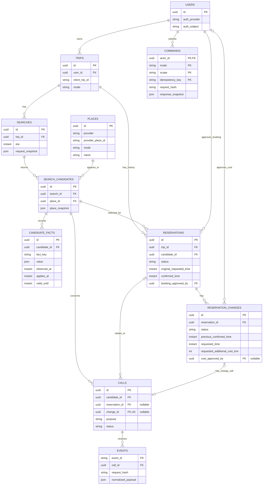

# Pleos 예약 비서 ERD 초안 v0.1

[REC-13 검색 기반 추천·직접 피드백](REC13_WEB_RECOMMENDATION.md) — #50의 기본 비활성 MOCK 실험 API와 사용자 입력/직접 평가 전용 V5 테이블입니다. 기존 v1·앱 계약/아래 논리 ERD 제안을 대체하지 않습니다.

작성일: 2026-11-06 · 공유본 갱신: 2026-11-07 KST. 상태: **팀 검토용 제안, DB·API 미적용**.

기준: `api/README.md`, `api/openapi.json`, `Model.java`, `WorkflowService.java`, `Store.java`, Flyway V1/V2. 현재 구현은 H2 + JSON payload 중심이며, 아래는 팀 개발을 위한 논리 모델입니다. PostgreSQL/MySQL 선택과 물리 타입·인덱스 문법은 아직 확정하지 않습니다.

이 문서는 Git으로 공유하는 **설계 검토본**입니다. 문서 게시가 스키마 확정이나 DB 적용을 의미하지 않습니다. 합의한 스키마는 별도 migration PR로 구현합니다.

함께 읽기: [이슈별 상세 해설](ISSUE_GUIDE.md) · [기능 명세서](FUNCTIONAL_SPEC.md) · [관계 개요 시각화](ERD.md#2-핵심-관계).

## 1. 제안 범위

핵심 업무 테이블 9개와 공통 처리 테이블 2개, 총 11개로 시작합니다. JSON은 검색 당시 조건·승인 내용·응답 원본처럼 함께 보존할 스냅샷에 사용하고, 관계·상태·예약 시각·비용·중복 키는 개별 필드로 관리합니다.

| 영역 | 테이블 | 역할 | 관련 이슈 |
| --- | --- | --- | --- |
| 사용자·여정 | users | 인증 주체와 데이터 소유자 | #4 |
| 사용자·여정 | trips | 같은 여정 식별, 재검색 간 중복 예약 차단 | #1 입력 계약, #4 저장 |
| 검색·추천 | searches | 검색 당시 ETA·동행 조건·취향 스냅샷 | #2, #4 |
| 검색·추천 | places | 외부 장소 식별과 기본 정보 | #2 |
| 검색·추천 | search_candidates | 특정 검색에 제시한 장소 | #2 |
| 검색·추천 | candidate_facts | 주차·아동 동행·대기·예약 가능 여부와 확인 근거 | #2, #3 |
| 예약 | reservations | 예약 요청 및 현재 확인된 예약 정보 | #4 |
| 예약 | reservation_changes | 변경 요청별 시각·비용·결과 이력 | #3, #4 |
| 전화 | calls | 문의·예약·변경 작업 | #3, #4 |
| 공통 처리 | events | 통화 결과 이벤트와 중복 검증 | #3, #4 |
| 공통 처리 | commands | 사용자 명령 중복 방지와 최초 응답 보존 | #4 |

Android/UX는 서버 API를 사용합니다. #5가 DB에 직접 접속하지 않습니다.

## 2. 핵심 관계

`||`는 정확히 1개, `o|`는 0 또는 1개, `o{`는 0개 이상입니다. 그림은 주요 필드만 표시합니다. 승인자 FK를 포함한 15개 관계를 표시하며 세부 필드는 아래 정의와 가져오기 SQL에서 확인합니다. `uuid`·`instant`·`json`은 논리 타입입니다.

관계가 1:N이어도 추가 업무 제약이 적용됩니다. 예를 들어 여정에 과거 예약은 여러 개일 수 있지만, `PENDING/CONFIRMED/UNKNOWN` 예약은 합쳐서 최대 1개입니다. 검색 결과의 후보 수도 물리적으로 3개로 제한하지 않고, 현재 제품 정책으로 3개를 반환합니다.

### ERDCloud와 가져오기 자료

- [ERDCloud 편집본](https://www.erdcloud.com/d/GLtbN3YfiazAMYi6X)은 비공개 도표입니다. 링크만으로 팀원 접근 권한이 생기지는 않으며, GitHub에서는 아래 Mermaid 관계도와 컬럼 정의를 읽을 수 있습니다.
- [가져오기 SQL](erd/ERDCLOUD_IMPORT.sql)과 [Mermaid 원본](erd/ERD.mmd)을 함께 공유합니다. SQL은 **ERD 가져오기용 표기**이며 Flyway migration이 아닙니다. 운영 DB는 아직 선정하지 않았습니다.
- 2026-11-06 ERDCloud 내보내기 대조: **11 테이블·107 컬럼·11 PK·15 FK**의 이름·타입·NULL·키 구성을 확인했습니다. commands의 복합 PK는 컬럼 집합 기준으로 대조했습니다.
- ERDCloud SQL 가져오기에서 아래 **UNIQUE 5개는 누락**되어 도표 메모에 적었습니다. 공유 SQL에는 보존되어 있습니다.

| 테이블 | UNIQUE 컬럼 | 목적 |
| --- | --- | --- |
| users | auth_provider, auth_subject | 인증 주체 중복 방지 |
| trips | user_id, mode, client_trip_id | 같은 사용자·모드의 여정 중복 방지 |
| places | provider, provider_place_id, mode | 사업자 장소 중복 방지 |
| search_candidates | search_id, place_id | 같은 검색의 장소 중복 방지 |
| calls | change_id | 변경 요청당 통화 작업 중복 방지 |

활성 예약·미해결 변경·BOOKING 통화 개수·소유권/모드 일치 같은 조건부 업무 제약은 위 SQL만으로 보장되지 않습니다. 실제 DB 선택 후 제약·트랜잭션·테스트로 구현해야 합니다.

## 3. 테이블별 필드 초안

### users — 사용자

- `id`: PK, 내부 UUID.
- `auth_provider`, `auth_subject`: 인증 제공자가 확인한 식별자. 두 필드의 조합은 UNIQUE.
- `created_at`, `updated_at`.
- 초기 MOCK 데이터는 가상 사용자를 사용합니다. 인증 도입 전 임의 user_id를 받는 것만으로 소유권 검증을 구현했다고 보지 않습니다.
- 가족 구성원의 실명·연락처를 이 테이블에 추가하지 않습니다. 현재 동행 조건은 검색 스냅샷에 기록합니다.

### trips — 여정

- `id`: PK, 서버 내부 UUID.
- `user_id`: FK → users, NOT NULL.
- `client_trip_id`: 현재 API의 `navigation.tripId`, 문자열 최대 100자.
- `mode`: MOCK/LIVE, NOT NULL.
- `created_at`, `updated_at`.
- UNIQUE(`user_id`, `mode`, `client_trip_id`). 같은 사용자의 같은 여정 재검색은 같은 행에 연결합니다.
- 목적지·ETA의 검색 시점 값은 searches에 보존합니다. 추후 최신 여정 상태를 저장하더라도 과거 검색 스냅샷을 덮어쓰지 않습니다.
- 여정 종료·목적지 변경 시 새 여정 생성 기준은 #1/#4에서 합의합니다. 새 ID 발급으로 활성 예약 중복 제한을 우회할 수 없도록 서버에서 소유권과 여정 정책을 검증해야 합니다.

### searches — 검색

- `id`: PK.
- `trip_id`: FK → trips, NOT NULL.
- `mode`, `eta`, `navigation_source`, `navigation_observed_at`, `created_at`.
- `request_snapshot`: 원래 SearchRequest 전체. 목적지, 성인/아동 수, 최대 대기, 필수 조건, 선호 음식, learningConsent를 포함합니다. 위 추출 필드와 같은 요청에서 생성합니다.
- 검색 입력은 변경하지 않습니다. 조건·ETA 변경은 같은 trip의 새 search를 생성합니다.
- 학습 동의는 검색 시점의 별도 값이며 예약·변경·추가 비용 승인으로 사용하지 않습니다. 실제 학습 기능 도입 전에는 동의 버전·철회 이력 모델을 별도로 설계합니다.

### places — 장소

- `id`: PK, 내부 장소 식별자.
- `provider`, `provider_place_id`, `mode`: 조합 UNIQUE.
- `name`, `cuisine`, `address`, `latitude`, `longitude`: 사업자 데이터 가용성에 따라 일부 nullable.
- `contact_ref`: 발신에 사용할 연락처의 관리 참조, nullable. 실제 번호·사업자 인증 정보는 fixture에 넣지 않습니다.
- `fetched_at`, `valid_until`: 가져온 기본 정보의 시각과 유효기간, 사업자 정책에 따라 nullable.
- 사업자 간 같은 매장 병합은 후속 범위입니다. 저장·재표시가 허용된 데이터만 보존합니다.
- 빈자리·예약 가능·현재 대기처럼 시점에 따라 달라지는 정보는 candidate_facts에 저장합니다.

### search_candidates — 검색 후보

- `id`: PK, 검색마다 새로 생성하는 후보 식별자.
- `search_id`: FK → searches, NOT NULL.
- `place_id`: FK → places, NOT NULL.
- `place_snapshot`: 검색 당시 표시한 매장명·음식 종류 등 허용된 기본 정보.
- `created_at`.
- UNIQUE(`search_id`, `place_id`). 같은 검색에서 같은 사업자 장소를 중복 제시하지 않습니다.
- 현재 fixture의 candidateId는 검색 간 반복될 수 있으므로 기존 데이터를 옮길 때 `(기존 search_id, 기존 candidateId)`로 매핑합니다.
- `eligible`, `bookable`, `missing`, `exclusionReasons`, 순위는 유효기간·필수 조건을 사용해 조회 시 계산합니다. 저장한 오래된 bookable=true만으로 예약하지 않습니다.

### candidate_facts — 후보에 대해 확인한 정보

- `id`: PK. `candidate_id`: FK → search_candidates, NOT NULL.
- `fact_key`: childFriendly / parking / seatsAvailable / reservationAvailable / nowWaitMinutes / arrivalWaitMinutes.
- `value`: boolean 또는 정수 등의 JSON 값. NULL/UNKNOWN과 false·0을 구분합니다.
- `mode`, `source`, `evidence_ref`, `observed_at`, `applies_at`, `valid_until`, `certainty`, `scope`.
- `certainty`: CONFIRMED/ESTIMATED/UNKNOWN. `scope`: GENERAL/NOW/ARRIVAL.
- `created_at`: 저장 시각. `observed_at`의 대체값으로 사용하지 않습니다.
- 이력은 새 행으로 추가합니다. `(candidate_id, fact_key)`에 UNIQUE를 걸지 않습니다.
- 적용 범위와 ETA가 맞는 관측 중 유효한 사실을 선택합니다. 늦게 도착한 오래된 관측이 최신 사실을 덮어쓰면 안 됩니다.
- source=CALL인 evidence_ref는 해당 후보의 calls.id에 연결되는지 서버에서 검증합니다. 이 초안의 evidence_ref는 여러 출처를 표현하는 논리 참조이며 DB FK는 아닙니다.

### reservations — 예약

- `id`: PK. `trip_id`: FK → trips. `candidate_id`: FK → search_candidates. 둘 다 NOT NULL.
- `mode`, `status`, `original_requested_time`, `confirmed_time`(nullable).
- `change_policy_snapshot`: enabled, latestTime, maxAdditionalCostKrw. 예약 승인 당시 정책을 고정합니다.
- `total_additional_cost_krw`: 수락된 변경 비용의 누계, 기본 0, 0 이상.
- `booking_approved_by`: FK → users, NOT NULL. 해당 trip 소유자여야 합니다.
- `booking_approved_at`, `booking_approval_snapshot`: 승인한 대상·시각·동행 인원·변경 정책·인증 근거 참조. 서버에서 검증한 승인 근거를 기록합니다.
- `created_at`, `updated_at`, `version`: 동시 수정 검증용 버전.
- `status`: 현재 계약과 동일하게 PENDING/CONFIRMED/REJECTED/UNKNOWN.
- candidate → search → trip과 reservation.trip_id가 일치해야 합니다. 단순 FK 두 개만으로 이 일치가 자동 보장되지는 않습니다. 물리 설계에서 복합 FK 또는 트랜잭션 검증을 선택합니다.
- `original_requested_time`은 불변입니다. `confirmed_time`은 명시적 수락과 요청 시각·비용 일치가 확인될 때만 갱신합니다.

### reservation_changes — 예약 변경 요청

- `id`: PK. `reservation_id`: FK → reservations, NOT NULL.
- `status`: 제안 값 PENDING/ACCEPTED/REJECTED/UNKNOWN.
- `previous_confirmed_time`: 요청 당시 예약의 confirmed_time 스냅샷.
- `requested_time`, `requested_additional_cost_krw`: 변경 요청 값, 불변.
- `accepted_time`, `accepted_additional_cost_krw`: 수락 검증 성공 때 기록, 그 전에는 nullable.
- `authorization_source`: POLICY/EXPLICIT. `authorization_snapshot`: 해당 작업에 적용한 정책 또는 명시적 승인 증빙. 이 필드가 자동 변경 기능의 구현 완료를 뜻하지는 않습니다.
- `cost_approved_by`: FK → users, nullable. `cost_approved_at`: nullable. 추가 비용이 0보다 크면 두 필드와 요청 비용에 대한 승인 증빙이 필수입니다.
- `created_at`, `resolved_at`(nullable), `result_reason`(nullable).
- 예약당 PENDING/UNKNOWN 변경은 최대 1개. UNKNOWN은 unresolved이며 resolved_at을 채우거나 자동 재발신하지 않습니다.
- 현재 계약의 변경 간격 10분은 모든 변경 요청 이력의 최근 created_at을 기준으로 검사합니다. 거절된 요청도 간격 계산에 포함합니다.
- 수락: 원 예약 confirmed_time과 누적 비용을 같은 트랜잭션에서 갱신합니다. 거절·미확인: 기존 confirmed_time을 유지합니다.

### calls — 문의·예약·변경 작업

- `id`: PK. `candidate_id`: FK → search_candidates, NOT NULL.
- `reservation_id`: FK → reservations, nullable. `change_id`: FK → reservation_changes, nullable UNIQUE.
- `mode`, `purpose`, `status`, `requested_time`, `additional_cost_krw`, `created_at`, `updated_at`.
- `purpose`: INQUIRY/BOOKING/CHANGE.
- `status`: 현재 계약의 PENDING/ANSWERED/ACCEPTED/REJECTED/UNKNOWN을 유지합니다. 연결·재생 등 사업자 상태는 이 업무 결과 상태와 분리합니다.
- `provider`, `provider_call_id`: 실제 연동 전 nullable. 사업자별 식별자 범위는 adapter 선정 후 확정합니다.
- `disclosure_snapshot`, `result_reason`(nullable).
- INQUIRY: reservation_id와 change_id가 NULL.
- BOOKING: reservation_id가 존재하고 change_id는 NULL. 예약마다 BOOKING 작업은 1개.
- CHANGE: 두 FK가 존재하고 change.reservation_id = calls.reservation_id여야 합니다. 해당 예약의 후보와 calls.candidate_id도 일치해야 합니다.
- 변경과 작업은 한 트랜잭션에서 생성합니다. 그림의 0..1은 생성 전·과거 자료의 불완전 상태까지 표현한 것이며, 접수 완료된 변경은 CHANGE 작업 1개를 가져야 합니다.
- 통화 완료나 ANSWERED는 예약 확정의 근거가 아닙니다. 확정 조건은 reservations 규칙과 events의 명시적 수락 정보를 함께 검사합니다.

### events — 통화 결과 이벤트

- `event_id`: PK, 현재 outcome API의 전역 고유 문자열(최대 100자).
- `call_id`: FK → calls, NOT NULL.
- `request_hash`: call_id와 정규화된 outcome 전체의 해시.
- `normalized_payload`: outcome, explicitAcceptance, observedAt, acceptedTime, additionalCostKrw, facts를 보존합니다.
- `received_at`, `processed_at`.
- 같은 event_id + 같은 본문/통화는 재처리하지 않습니다. 다른 내용/통화에 재사용하면 충돌입니다.
- 실제 사업자 이벤트 ID가 계정 범위에서만 고유하면 adapter에서 사업자·계정 범위를 포함한 안정적인 전역 event_id를 생성합니다. 단순히 사업자 원본 ID를 전역 고유하다고 가정하지 않습니다.
- 현재는 유효한 결과 반영과 이벤트 기록을 같은 트랜잭션으로 처리합니다. 원본 웹훅 inbox·서명 검증·처리 실패 이력은 LIVE 단계에서 추가합니다.

### commands — 명령 멱등성

- 복합 PK: `actor_id`(FK → users), `mode`, `scope`, `idempotency_key`.
- `request_hash`, `response_snapshot`, `created_at`.
- scope는 현재처럼 작업 종류와 대상 ID를 포함합니다. 예: booking:<searchId>, change:<reservationId>.
- 같은 사용자·mode·scope·key에 같은 요청이면 최초 응답을 반환합니다. 다른 요청이면 KEY_REUSED입니다.
- 응답 스냅샷은 이후 예약 상태가 바뀌어도 변경하지 않습니다. 최신 상태는 GET으로 확인합니다.
- 인증·소유권 확인 후 명령 결과를 조회합니다. 다른 사용자의 최초 응답이 유출되지 않아야 합니다.
- 만료·삭제 정책은 별도 결정합니다. 미해결 UNKNOWN을 두고 키를 지워 재발신을 허용하면 안 됩니다.

## 4. 초기부터 지킬 무결성 규칙

| 규칙 | 설계·구현 위치 |
| --- | --- |
| 같은 사용자의 같은 여정 식별 | trips의 복합 UNIQUE |
| 여정당 활성 예약 최대 1개 | PENDING/CONFIRMED/UNKNOWN을 하나의 집합으로 제한. DB 종류에 맞는 제약 + 여정 단위 트랜잭션 잠금 |
| 예약당 미해결 변경 최대 1개 | PENDING/UNKNOWN을 하나의 집합으로 제한. DB 종류에 맞는 제약 + 예약 단위 잠금 |
| 명령·결과 이벤트 중복 차단 | commands 복합 PK / events PK + 본문 해시 대조 |
| 서로 다른 여정·후보의 참조 연결 방지 | 후보·검색·예약·변경·통화의 소속 일치 검증, 필요 시 복합 FK |
| MOCK/LIVE 혼합 방지 | trip/search/place/fact/reservation/call의 모드를 작업 경계에서 검사. MOCK 결과로 LIVE 예약을 확정하지 않음 |
| 시각·비용 일치 후 확정 | 명시적 수락·요청 시각·추가 비용 대조 후 상태 변경. 누적 정책 상한 검사 |
| 조회 시 정보 만료 반영 | candidate_facts의 scope/applies_at/valid_until을 사용해 후보 적격·예약 가능 여부 재평가 |

`UNIQUE(trip_id, status)`만으로 활성 예약 1개를 보장할 수 없습니다. 서로 다른 활성 status의 예약이 동시에 들어갈 수 있기 때문입니다. 해당 제약의 실제 DDL은 DB 선택 후 테스트와 함께 작성합니다.

시간은 UTC 절대 시각으로 저장하고 화면에서 KST로 표시합니다. 금액은 정수 KRW, 대기는 분입니다. PK/FK 타입은 일치시킵니다. 실수형 금액을 사용하지 않습니다. 업무 레코드 삭제는 기본 RESTRICT로 두고 보관·삭제 정책을 별도 합의합니다.

초기 조회 인덱스 후보:

- searches(`trip_id`, `created_at`)
- search_candidates(`search_id`, `place_id`) UNIQUE
- candidate_facts(`candidate_id`, `fact_key`, `scope`, `observed_at`)
- reservations(`trip_id`, `status`)
- reservation_changes(`reservation_id`, `status`, `created_at`)
- calls(`candidate_id`, `purpose`, `created_at`), calls(`reservation_id`, `purpose`)
- events(`call_id`, `received_at`)

인덱스는 조회·데이터 규모를 확인해 조정합니다. 위 목록이 부분 UNIQUE나 업무 제약을 대신하지 않습니다.

## 5. 현재 코드와 연결하는 방법

현재 물리 테이블은 searches, reservations, calls, commands, events, command_mutex의 6개입니다. V1/V2에서 DB FK가 실제로 있는 관계는 searches → reservations, searches → calls, calls → events입니다. `events.call_id`는 V1에 이미 FK로 선언되어 있습니다. JSON 안의 candidateId/reservationId 등은 DB FK로 보장되지 않습니다.

| 현재 구조/필드 | 초안에서의 위치 |
| --- | --- |
| searches.payload.request | searches.request_snapshot, trips 소유권 연결 |
| searches.payload.candidates[] | places + search_candidates + candidate_facts |
| reservations.payload와 trip_id | reservations의 명시적 필드와 내부 trips.id FK |
| bookingCallId | calls에서 purpose=BOOKING인 예약 작업 1개를 조회해 API에 반환 |
| pendingChangeCallId | PENDING/UNKNOWN 변경과 연결된 CHANGE call을 조회해 API에 반환 |
| changeCallIds / lastChangeRequestedAt | reservation_changes + calls 이력에서 반환 |
| calls.payload | calls의 명시적 필드. searchId는 candidate → search 관계에서 반환 |
| events.payload | events.normalized_payload + 기존 call FK 유지 |
| commands의 scope/key | 사용자·mode를 추가한 범위로 확장 |
| command_mutex | 현재 구현에서 유지. 여정/예약별 동시성 검증 후 제거 여부 결정 |

순환 FK를 줄이기 위해 reservations에 booking_call_id/pending_change_call_id를 중복 저장하지 않는 안입니다. API 응답에는 기존 필드명을 유지할 수 있지만, 응답 조립과 Store 구현을 수정하고 계약 테스트로 확인해야 합니다.

예약을 먼저 만들고 BOOKING call을 같은 트랜잭션에서 생성하는 순서가 필요합니다. 현재 코드는 call을 먼저 저장하므로 FK만 추가해서는 전환이 완료되지 않습니다. 기존 candidateId의 검색별 매핑, tripId의 내부 ID 매핑, 기존 events.call_id FK 유지도 데이터 이관에 포함합니다.

## 6. 팀 검토와 반영 순서

1. #4가 소유권·예약/변경·중복 제약을 검토하고 #2/#3이 후보 정보·전화 결과 필드를 확인합니다. #1/#5는 API ID와 상태 의미를 확인합니다.
2. 운영 DB 종류, 사용자 인증 식별자, 여정 식별/종료 기준을 결정합니다.
3. 기존 V1/V2를 변경하지 않고, 선택한 DB에서 실행할 migration과 기존 H2 데이터 이관/개발 DB 재생성 전략을 별도 PR로 작성합니다. H2 CLOB과 JSON 저장 코드를 실제 DB에 맞게 검증합니다.
4. 가상 데이터 seed와 같은 DB 종류의 통합 테스트를 추가합니다. 동시 중복 예약, 같은 이벤트 재전송, 변경 UNKNOWN의 원 예약 보존을 확인합니다.
5. ERD·migration·API·Store·테스트를 함께 갱신한 뒤 팀원이 같은 환경에서 재현합니다.

LIVE 도입 전에는 webhook inbox/서명 검증, 발신 outbox와 전송 식별자 대조, 비용·횟수 제한, UNKNOWN 수동 해결 감사 이력, 개인정보 보관·삭제 정책이 추가로 필요합니다. 이 초안의 11개 테이블만으로 실제 전화 연동 준비가 완료되지는 않습니다.

## 7. 초안 검토 체크

- [ ] 사용자/여정/검색/후보/예약/변경/통화의 소유권과 FK 경로 합의
- [ ] places 저장 허용 범위 및 사업자 식별 방식 합의
- [ ] 예약 승인·변경 정책·추가 비용 승인 증빙 형식 합의
- [ ] NOW/ARRIVAL 및 정보 유효기간 선택 규칙 합의
- [ ] 활성 예약·미해결 변경의 DB 제약 구현 방식 결정
- [ ] DB 종류와 기존 H2 데이터 처리 방식 결정

이 문서는 코드/API 대조를 거친 설계 초안입니다. DDL 실행, migration, 서비스 동작 변경, 실전화, 유료 API 실행은 수행하지 않았습니다.

## 8. 최근 논의와 미확정 확장

현재 계약은 동일 여정의 활성 예약 최대 1개를 유지합니다. 식당+카페 등 다중 방문 예약은 `trips → trip_stops → reservations` 확장 후보이며 현재 11개 테이블과 코드에는 없습니다. 지연 감지·변경 제안 등 차별화 방향도 [설계 제안](DESIGN_PROPOSALS.md)에서 별도로 검토합니다. 사용자 질문이나 문서 게시만으로 정책을 변경한 것으로 간주하지 않습니다.
